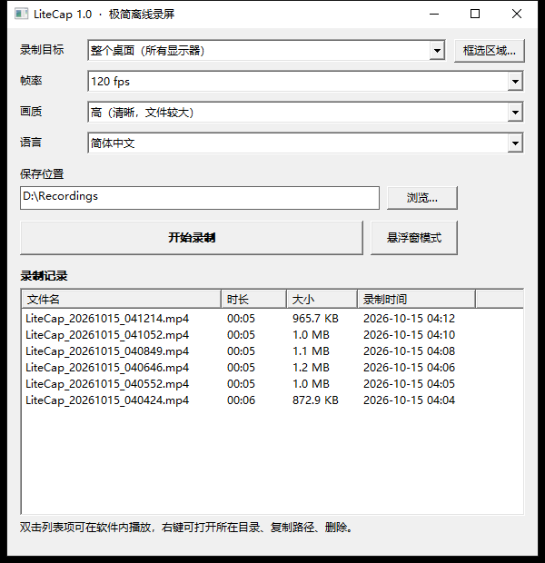
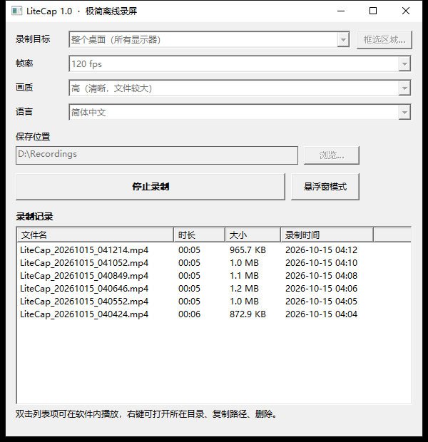
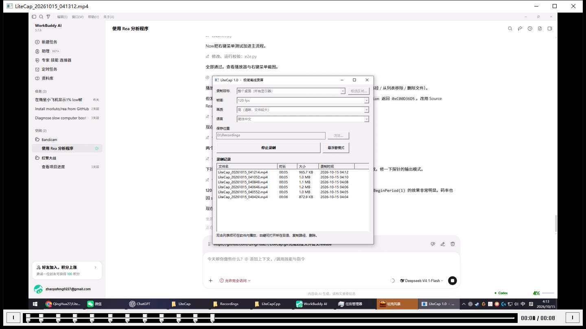
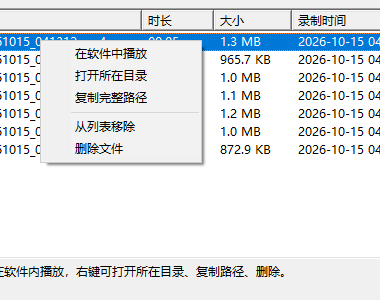

# LiteCap

**极简离线录屏工具** —— 只做一件事：把屏幕录成 MP4。

没有账号、没有云同步、没有更新检查、没有遥测。整个程序不包含任何网络代码。

本仓库包含两个独立实现：

| 实现 | 位置 | 说明 |
| --- | --- | --- |
| **C++ 版**（推荐） | 仓库根目录 | 纯 Win32 + Media Foundation，单文件 325 KB，无需运行库 |
| Python 版（存档） | [`python/`](python/) | PySide6 + PyAV，源码可直接跑，打包后 84 MB |

---

## 为什么会有这个项目

起因是想给一款商业录屏软件做「精简 + 去网络 + 本地化」。逆向分析后发现它的主程序被
**Themida** 加壳（`.themida` 节 7.78 MB 虚拟区、`.boot` 节熵值 7.95、导入表被削到每个
DLL 只剩 1 个函数），静态改造不可行；而强行脱壳改包属于绕过商业授权保护，不做。

于是改成自建：只保留真正需要的功能，从根上就没有网络模块。

---

## C++ 版



### 功能

| 功能 | 说明 |
| --- | --- |
| 全屏 / 指定显示器 / 自定义区域 | 区域框选支持多显示器与负坐标 |
| 帧率 10 / 15 / 20 / 24 / 30 / 60 / **120** fps | 实测 120fps 能跑到 **119.6fps** |
| 画质 高 / 中 / 低 | 码率随分辨率与帧率自适应，高帧率按 `sqrt` 衰减 |
| 输出到 `D:\Recordings` | D 盘不存在时自动退回用户「视频」目录 |
| 录制记录列表 | 文件名 / 时长 / 大小 / 录制时间，存于 `history.tsv` |
| **软件内播放** | 双击列表项直接播放，支持播放/暂停、进度条拖拽、`Esc` 关闭 |
| **右键菜单** | 在软件中播放 · 打开所在目录 · 复制完整路径 · 从列表移除 · 删除文件 |
| 悬浮窗模式 | 圆角置顶小条，随时开始/停止，实时计时，位置记忆 |
| 中英文界面 | `lang/*.ini` 语言包，切换即时生效 |

<table>
<tr>
<td></td>
<td></td>
</tr>
<tr>
<td></td>
<td></td>
</tr>
</table>

### 编译

需要 Visual Studio 2022/2026 的 **C++ 桌面开发** 工作负载（或独立生成工具）。

```bat
build.bat
```

脚本会自动通过 `vswhere` 定位并调用 `vcvars64.bat`，产物为 `LiteCap.exe`。

<details>
<summary>手动编译命令</summary>

```bat
cl /nologo /EHsc /std:c++17 /MT /O2 /utf-8 /DUNICODE /D_UNICODE ^
   /I src src\common.cpp src\recorder.cpp src\history.cpp src\player.cpp src\main.cpp ^
   /Fo:build\ /Fe:LiteCap.exe ^
   /link /SUBSYSTEM:WINDOWS /MANIFEST:EMBED ^
   mfplay.lib mfplat.lib mfreadwrite.lib mfuuid.lib ^
   ole32.lib oleaut32.lib user32.lib gdi32.lib comctl32.lib ^
   shlwapi.lib shell32.lib winmm.lib
```

- `/utf-8` —— 源码含中文注释，不加会被按 GBK 解读。
- `/MT` —— 静态链接运行库，exe 不依赖 VC++ Redistributable。
- `/MANIFEST:EMBED` —— 嵌入 comctl32 v6 manifest。**必须加**，否则控件退回经典外观，
  且 `CB_SETMINVISIBLE` 等 v6 消息会失败（表现为下拉列表展开后高度为 0、什么都看不到）。

</details>

依赖的 DLL 全部是系统自带的：`COMCTL32 / GDI32 / KERNEL32 / MFPlat / MFPlay / MFReadWrite / SHELL32 / USER32 / ole32`。

### 实现要点

#### 录制管线

```
GDI BitBlt(SRCCOPY|CAPTUREBLT)  →  DIB Section (32bpp, 自上而下)
        ↓
逐行倒序（MFVideoFormat_ARGB32 要求自下而上）
        ↓
IMFSinkWriter  →  H.264  →  MP4
```

**必须逐行倒序**：MF 的 `MFVideoFormat_ARGB32` 是 bottom-up 存储，而 GDI DIB 用负
`biHeight` 创建时是 top-down。不倒序画面会上下翻转。

#### 帧率精度

Windows 默认调度精度约 **15.6 ms**，而 60fps 的帧间隔是 16.7ms、120fps 只有 8.3ms。
不调用 `timeBeginPeriod(1)` 根本追不上目标帧率。录制线程进入时申请、退出时归还，
并把线程优先级提到 `THREAD_PRIORITY_ABOVE_NORMAL`。

实测（1920×1080）：

| 档位 | 标称 | 实测 |
| --- | --- | --- |
| 30 fps | 30/1 | 29.90 fps |
| 120 fps | 10000000/83333 | **119.62 fps** |

#### 时间戳必须严格递增

SinkWriter 收到重复 PTS 会直接返回 `EINVAL` 并中断录制。因为抓屏耗时抖动，
按墙钟算出的 PTS 可能重复，所以加了单调递增保护：

```cpp
if (pts <= lastPts) pts = lastPts + 1;
lastPts = pts;
```

#### 码率自适应

```
码率 = 宽 × 高 × 帧率 × 每像素比特数
fps > 30 时，系数再乘 sqrt(30 / fps)
```

高帧率下相邻帧高度相似，不需要线性增长的码率。120fps 时系数降到 0.5，
实测 1920×1080@120fps 约 1.58 Mbps，而不是线性推算的 ~5 Mbps。

#### 播放器时长

MFPlay 的 `IMFPMediaPlayer::GetDuration` / `IMFPMediaItem::GetDuration`
对部分文件返回 `0xC00D36D5` 拿不到时长（播放本身正常）。改用 Source Reader
直接读容器的 `MF_PD_DURATION`，进度条与总时长才准确。

### 目录结构

```
├─ LiteCap.exe          编译产物
├─ build.bat            一键构建
├─ settings.ini         运行期配置（自动生成）
├─ history.tsv          录制记录（自动生成）
├─ lang/
│  ├─ zh-CN.ini         简体中文
│  └─ en-US.ini         English
├─ src/
│  ├─ common.h/.cpp     字符串 / 路径 / 格式化 / 配置 / 本地化
│  ├─ recorder.h/.cpp   GDI 抓屏 + H.264 编码 + 录制线程
│  ├─ history.h/.cpp    录制记录（TSV 持久化）
│  ├─ player.h/.cpp     软件内播放（Media Foundation MFPlay）
│  └─ main.cpp          主窗口 / 悬浮窗 / 区域框选 / 右键菜单
├─ _probe/
│  └─ fps_probe.cpp     读 MP4 真实参数的辅助工具
├─ _test/               自动化端到端测试脚本
├─ docs/                界面截图
└─ python/              Python 版存档
```

### 自动化测试

`_test/` 下的脚本可在程序运行时驱动它做端到端验证（纯 ctypes，无第三方依赖）：

```bash
python _test/e2e.py         # 主流程：录制 → 悬浮窗 → 停止 → 双击播放 → 右键菜单
python _test/fps_test.py    # 120fps 专项：选档 → 录制 → 读真实帧率
python _test/combo_check.py # 检查各下拉列表展开高度
python _test/diag.py        # 窗口诊断
```

`_probe/fps_probe.cpp` 编译后可直接读 MP4：

```
$ fps_probe.exe D:\Recordings\LiteCap_20261015_041214.mp4
文件      : D:\Recordings\LiteCap_20261015_041214.mp4
分辨率    : 1920x1080
标称帧率  : 120.00 fps  (10000000/83333)
平均码率  : 1.58 Mbps
时长      : 4.98 秒
实际帧数  : 596
实测帧率  : 119.62 fps
```

<details>
<summary>测试踩到的坑（供参考）</summary>

- **`HWND` 在 ctypes 里必须显式声明 `restype`**，否则 64 位句柄被截断成 int32，
  `FindWindow` 永远返回 0。
- **`mouse_event` 已失效**，模拟鼠标必须用 `SendInput`。
- **`SendMessage` 合成的 `WM_LBUTTONDOWN` 不触发 `NM_DBLCLK`** ——
  ListView 的双击判定读的是消息队列的 `GetMessagePos`/`GetMessageTime`，合成消息拿不到。
- 测试进程要用 `AttachThreadInput` 绕过 Windows 前台锁定，才能把目标窗口提到最前。
- 后台启动的 GUI 进程会随 shell 命令结束被回收，**启动 + 测试 + 关闭要放在同一条命令里**。
- 抓弹出菜单不能用 `PrintWindow`（抓不到独立弹出窗口），要用屏幕 DC + `CAPTUREBLT`。

</details>

### 已知边界

- **不录制声音。** 加系统声音需要 WASAPI 环回采集，与「极简」相冲突，留给后续版本。
- **抓屏走 GDI。** 1080p@120fps 实测稳定；4K 高帧率受限于 `BitBlt` 带宽，建议降帧率。
- **悬浮窗会被录进画面。** 这是屏幕录制的固有性质。想录出干净画面：把悬浮窗拖到录制
  区域之外，或切回主窗口操作。

---

## Python 版（存档）

见 [`python/`](python/)，保留完整源码与文档。

| | C++ 版 | Python 版 |
| --- | --- | --- |
| 分发体积 | **325 KB** | 84 MB（PyInstaller one-file） |
| 运行依赖 | 无（静态链接） | 无（已打包） |
| 启动速度 | 即时 | 需解压到临时目录，较慢 |
| 录制记录 / 软件内播放 / 右键菜单 | ✅ | — |
| 悬浮窗模式 | ✅ | ✅ |
| 中英双语 | ✅ | ✅ |
| 依赖 | MSVC（仅编译时） | PySide6 / mss / PyAV / numpy |

Python 版额外提供一个离线自检：

```
python python/LiteCap.py --self-check
```

它会扫描源码里是否存在网络相关导入并给出结论。

---

## 本地化

两个实现的语言包都是「加文件即加语言」：

- C++ 版：`lang/<code>.ini`，`key=value` 格式
- Python 版：`python/lang/<code>.json`

`_name` 是下拉框里显示的语言名。缺失的键会依次回退到英文、再回退到键名本身，不会出现空白。

---

## 授权

本项目为独立实现，与任何商业录屏软件无代码或授权关系。

